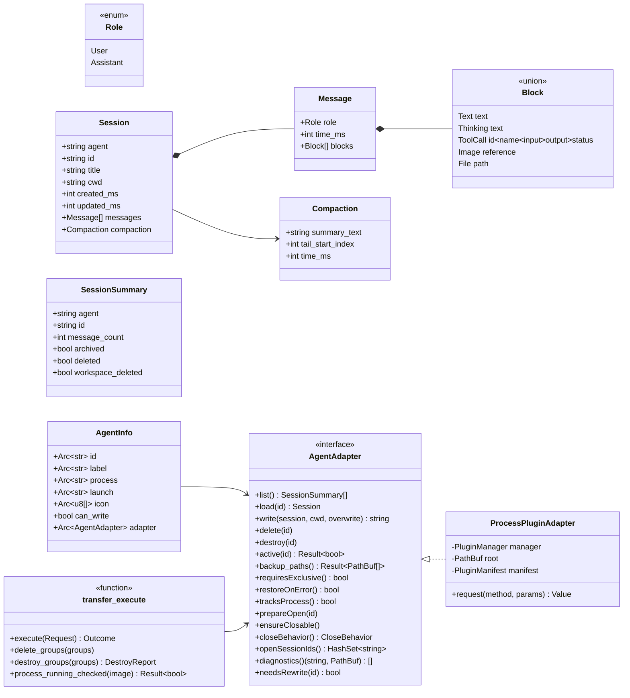
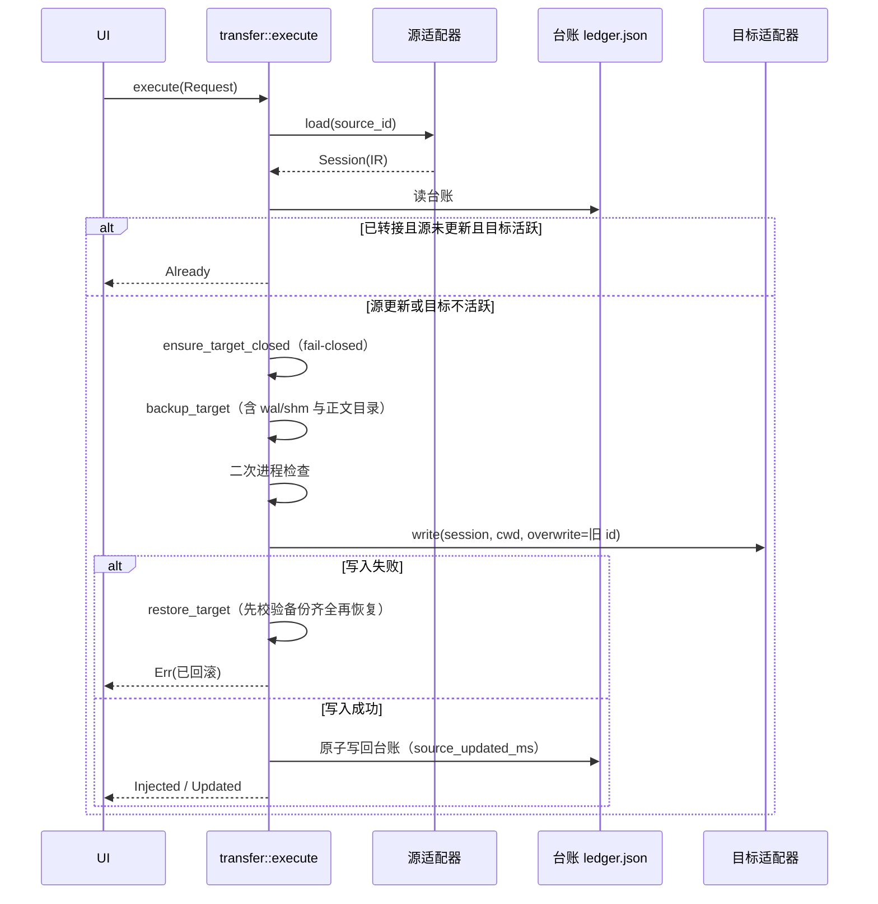

# 架构与适配器

专题文档：[插件架构](plugin-architecture.md)、[功能](features.md)、[存储](storage.md)、[安全](safety.md)、[二进制加固](security.md)、[限制](limitations.md)。

## 目标

- 在已安装插件声明的 agent 之间做原生转接；新增 agent 只新增插件，不修改转接引擎。
- 用统一 IR 承载跨 agent 的公共语义；产品私有字段不进 IR，读取时丢弃或降级为文本。
- 目标不支持的内容在写入端降级为纯文本引用，不做能力声明。

## 设计原则

不同 agent 的事件类型、状态取值、上下文结构与模式字段同名不同义。按字段名合并会得到一张大部分为 null 的宽表，转换仍需按 agent 分支。IR 只保留各端都能表达的公共语义，多余的产品状态在读取端止步。

宿主不实现 agent 特化逻辑。agent 的读取、写入、删除与销毁由插件提供，宿主只负责调度、校验、备份、回滚与界面。插件边界与包规范见 [plugin-architecture.md](plugin-architecture.md)。

## 统一 IR

定义在 `agent-core/src/ir.rs`，宿主与插件共用。IR 是扁平结构：

```rust
pub enum Role { User, Assistant }

pub enum Block {
    Text(String),
    Thinking(String),
    ToolCall { id: String, name: String, input: serde_json::Value,
               output: Option<String>, status: String },
    Image { reference: String },
    File { path: String },
}

pub struct Message { pub role: Role, pub time_ms: i64, pub blocks: Vec<Block> }

pub struct Session {
    pub agent: String, pub id: String, pub title: String, pub cwd: String,
    pub created_ms: i64, pub updated_ms: i64, pub messages: Vec<Message>,
    pub compaction: Option<Compaction>,
}

pub struct SessionSummary {
    // Session 的摘要字段 + message_count + archived/deleted/workspace_deleted
}
```

目标不支持的内容由各写入器就地降级，工具状态经 `agent_core::text::tool_status` 归一。四个状态旗标由插件从自有存储推导，UI 据此分四态展示。

## 适配器

```rust
pub trait AgentAdapter: Send + Sync {
    fn list(&self) -> Result<Vec<SessionSummary>>;
    fn load(&self, id: &str) -> Result<Session>;
    fn write(&self, session: &Session, cwd: &str, overwrite: Option<&str>) -> Result<String>;
    fn delete(&self, id: &str) -> Result<()>;
    /// 物理销毁。默认复用 delete。
    fn destroy(&self, id: &str) -> Result<()> {
        self.delete(id)
    }
    /// 查询失败必须保留错误，不能把存储或 IPC 故障误判为“不活跃”。
    fn active(&self, id: &str) -> Result<bool>;
    /// 备份范围查询同样可失败；空列表只代表真实的空范围。
    fn backup_paths(&self) -> Result<Vec<PathBuf>>;
    fn requires_exclusive(&self) -> bool { true }
    fn restore_on_error(&self) -> bool { true }
    fn tracks_process(&self) -> bool { true }
    fn prepare_open(&self, _session_id: Option<&str>) -> Result<()> { Ok(()) }
    fn ensure_closable(&self) -> Result<()> { Ok(()) }
    fn close_behavior(&self) -> CloseBehavior { CloseBehavior::Process }
    fn open_session_ids(&self) -> Option<HashSet<String>> { None }
    fn diagnostics(&self) -> Vec<(&'static str, PathBuf)> { Vec::new() }
    fn needs_rewrite(&self, _id: &str) -> bool { false }
}
```

宿主只实现一个通用 `ProcessPluginAdapter`，按 manifest 声明、注册握手 SHA-256 与逐方法能力位校验每一次调用。注册表是运行时快照，返回 `Arc<AgentInfo>`：

```rust
pub struct AgentInfo {
    pub id: Arc<str>,
    pub label: Arc<str>,
    pub process: Arc<str>,
    pub launch: Arc<str>,
    pub icon: Arc<[u8]>,        // 来自插件包的 icon.png
    pub can_write: bool,
    pub adapter: Arc<dyn AgentAdapter>,
}
```

UI 的筛选、计数、图标、目标下拉全部从运行时注册表生成。宿主源码不包含 agent 特化适配器、插件 crate 依赖或 `src/agents/` 包装目录。

新增 agent：按 [plugin-architecture.md](plugin-architecture.md) 建立独立插件包，把存储能力、协议入口、manifest 和图标放在同一个包内，导入 zip 即接入。需要安装检测时，在插件 manifest 的 `variant.detectors` 里声明；能用已有检测器类型时只改 manifest，需要新检测方式才改宿主检测器代码。

## 转接流程

引擎是 `src/transfer.rs` 的自由函数 `execute(&Request)`：

```text
UI/CLI 构造 Request{source, source_id, target, target_cwd, mode}
  → 源适配器 load()，得到 IR
  → mode=Export：export_with_config 按设置导出普通文档或交接文档，结束
  → 读台账 ledger.json：命中且源未更新且目标活跃 → 返回 Already
    命中但源更新或目标不活跃 → 以原 target_id 覆盖写入
  → 进程检查（fail-closed）：目标运行中返回 TargetRunning，
    tasklist 探测失败按错误中止，绝不放行写入
  → 整库备份（含 -wal/-shm 与正文目录）到 backups/，随后二次进程检查
  → 设置开启「仅注入最近压缩之后的消息」时：按最近压缩边界截断 IR 消息
  → 目标适配器 write()：插件事务 + 临时文件替换；任一步失败
    → restore_target()：先校验备份齐全再删除目标文件，逐条恢复并汇总失败
  → 成功后台账原子写回（临时文件 + rename），记录 source_updated_ms
  → 目标会话恢复活跃：清除归档、删除标记，恢复所属工作区或项目
```

台账损坏时保留现场（改名 `ledger.json.corrupt-<时间戳>`）并重建空台账，避免旧映射造成目标端重复。

## 导出

只有两种文档：普通文档与交接文档，两套生成器、一个编排入口：

- `export::markdown_with`：全量消息、思考、工具调用与截断输出；`normal.tool_results` 关闭时保留工具名与参数、不写结果正文。
- `export::handoff::handoff_markdown`：按固定规则从原文裁剪重排，不调用模型、不联网，规则见 [handoff-export.md](handoff-export.md)。
- `export_with_config(session, mode)`：读 `config.json` 中对应分类的 `tool_results` 开关，写 `exports/normal|handoff/`；批量导出与转接对话框都走它。

## 删除流程

```text
UI 勾选会话 → 「选择」→ 按 agent 汇总并确认 → 二次确认
  → 目标进程检查（需要排他的插件 fail-closed）
  → 分组备份 → 目标进程复查 → 按插件顺序调用 delete
  → 失败时回滚可回滚的插件 → 清理旧备份 → 刷新列表
```

删除按插件原生语义执行，分软删除与硬删除两类。软删除只写标记，索引行与正文留在原处；硬删除移除存储行或文件，误删只能靠删除前备份恢复。具体语义由插件声明并记录在插件包 README。

批量删除按 agent 分组，每组独立备份，备份目录名带 agent id；目标进程在备份前后各检查一次。任一插件删除失败时恢复本批次全部备份，已成功删除的插件一并还原。恢复前目标应用已启动时拒绝自动恢复。操作成功后清理旧备份。

## 销毁流程

销毁是源端只读原则的显式例外：物理删除正文、数据库记录与索引项，不可恢复。只能由界面批量操作触发，入口是 `transfer::destroy_groups`。测试、脚本与自动流程不得调用。

```text
UI 勾选 → 「销毁」→ 确认框列出选中分布，勾选「我已知晓不可恢复」后按钮可用
  → 目标进程检查（需要排他的插件 fail-closed）
    → 逐插件整库备份 → 单插件内逐条事务删除
  → 某插件失败即停止该插件的后续删除（不回滚、其余插件继续）→ 逐条报告
```

## Agent 管理与垃圾会话

- 产品、形态、检测器、产品色、默认打开与渠道 id 全部来自已安装插件的 manifest variants。宿主运行时用 `catalog::from_plugins()` 组装目录，`installs::scan()` 按这些声明逐形态检测；插件未安装时产品不出现。未知检测器类型跳过并写检查日志。
- 检测器类型由宿主实现，检测参数由 manifest 声明。扫描只读，不启动目标应用。
- 每次进入 Agent 管理页重新扫描；结果按形态写入 `installs.json`，冷启动先读缓存即时显示，扫描完成后覆盖。文件缺失或损坏时回退为等待本次扫描。
- 版本检测在后台线程只发 GET。渠道默认值来自已安装插件 manifest 的 variant update 声明；解析规则由插件声明为通用 json/key/regex/html_regex/text 格式，宿主不保留产品专用 parser。
- 默认打开形态：本机设置优先，其次目录 `default_open_variant` 建议，再次剩余已安装可打开形态中的第一个。
- 垃圾会话来自各插件 `list()` 中 `message_count = 0` 且未删除的条目。

## 字段映射

IR 映射、压缩边界、会话状态与正文格式由各插件实现并记录在插件包 README。宿主只依赖 IR 的公共语义，不读取任何 agent 私有字段。

## UML

类图：



时序图，对应 `transfer::execute`：



## 源码布局

```text
agent-core/               IR、插件协议、serve()、路径/时间/文本/JSONL/SQLite 公共能力
plugins/<id>-plugin/      独立插件包；包结构与依赖规则见 plugin-architecture.md
src/
  agents.rs            运行时注册表与通用 AgentAdapter 契约；无 agent 特化代码
  plugins/             通用插件宿主：manifest、archive、registry、进程、发现、导入
  transfer.rs          转接引擎：台账、进程闸门、备份与回滚
  config.rs            config.json：主题三态、导出开关、截断、自动检查、默认打开形态、插件根目录
  export/mod.rs        双导出编排：export_with_config → normal/handoff
  export/handoff.rs    交接文档生成器
  catalog.rs           产品/形态目录：由已安装插件 manifest 组装
  installs.rs          安装扫描：目录驱动的逐形态检测与缓存
  updates.rs           版本检测：渠道源加载、比较与解析
  open/mod.rs          启动与关闭 agent 进程、默认打开形态解析
  main.rs              GUI 入口 + CLI doctor/transfer/plugin
  ui/                  Slint 界面：组装、回调、状态、主题、事件泵、DPI
package-plugins.cmd    生成 dist/plugins/<id>-<version>.zip 可导入插件包
```
